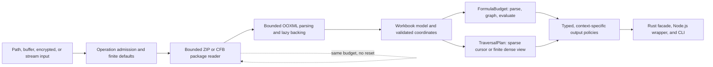
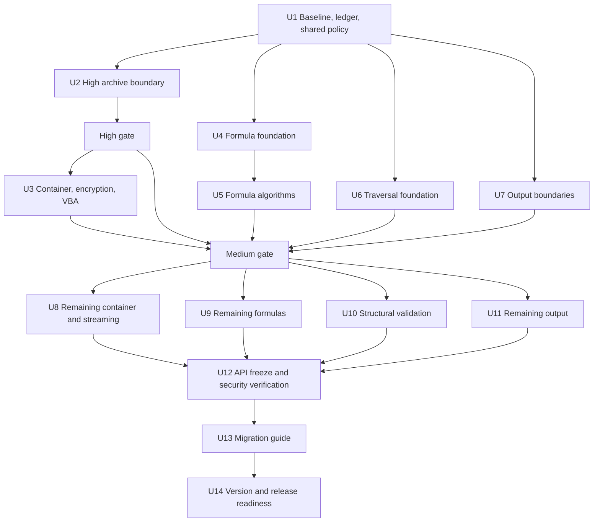

# SheetKit 1.0 Security Remediation

## Goal Capsule

Remediate all 77 reportable findings from Codex Security deep scan
`7e92b533-9ea8-4411-b4a9-252f9fb57dc2` before SheetKit 1.0. Work proceeds by
severity—High, then Medium, then Low—while allowing isolated root-control work
to run in parallel when it does not weaken that integration order.

The release may intentionally break pre-1.0 APIs and defaults to establish
secure, consistent Rust, Node.js, and CLI behavior. Normal supported workloads
must not incur a material performance regression. A separate bilingual
v0.5.1-to-1.0 migration guide must cover both the security remediation and all
earlier `prepare-v1` changes.

Success means every finding is mapped to a root control and an observable
regression scenario, secure defaults apply across all equivalent entry points,
normal workload performance stays within the defined gate, and the complete
repository verification matrix passes.

---

## Product Contract

### Requirements

- **R1 — Complete scope:** Address all 77 reportable findings. SK-DS-075 stays
  excluded because the scan classified it as ignored; it is not silently
  promoted into scope.
- **R2 — Severity-led delivery:** Complete and integrate the High finding before
  declaring Medium findings complete, and Medium before Low. Lower-severity
  prerequisites may land earlier with the root control they enable.
- **R3 — Secure 1.0 defaults:** All public Rust, Node.js, and CLI entry points
  use finite resource policies and context-safe output by default. A trusted
  profile may raise independently named finite ceilings, but cannot disable
  arithmetic safety, structural validation, output encoding, macro-format rules,
  or error sanitation. There is no public literal unbounded profile.
- **R4 — Cross-surface parity:** Equivalent Rust and Node.js operations share
  defaults, error categories, limit boundaries, and output policy. CLI behavior
  uses the same core policies where applicable.
- **R5 — Fail closed and atomic:** Limit violations produce stable typed errors
  without panic, partial mutation, truncated success, or attacker-sized
  allocation. Non-streaming operations stage results before commit. File saves
  publish a validated temporary result atomically and preserve any existing
  destination on failure. Streaming policy/structure failures occur before the
  first emitted byte; later external sink failures are reported, never success.
- **R6 — Data integrity:** Accepted workbooks preserve lazy copy-on-write,
  unknown-part round trips, encryption interoperability, and macro semantics
  appropriate to the target workbook format.
- **R7 — Performance:** Use two independent baselines: revision `150e579` judges
  remediation cost and tag v0.5.1 judges cumulative user-visible upgrade impact.
  Representative normal workloads target no more than 5% median latency or
  peak-memory regression after accounting for measured noise and a small
  absolute floor. More than 10% on any primary workload is a release blocker
  unless the user explicitly accepts it; workload averages cannot hide a stop.
  Security rejection paths remain bounded independently of attacker-declared
  expansion or coordinate span.
- **R8 — Migration:** Publish English and Korean migration guides from v0.5.1 to
  1.0.0, including earlier `prepare-v1` changes, new security defaults, API and
  error changes, compatibility implications, performance notes, and before/after
  examples.
- **R9 — Verification:** Validate root controls at their exact boundaries,
  replay exploit fixtures, prove surface parity, run interoperability checks,
  and pass all repository build, test, lint, format, package, and docs gates.

### Acceptance Flows

- **F1 — Untrusted workbook open:** A caller opens the same malicious package by
  path, buffer, password, eager, lazy, or streaming API. The same operation-wide
  budget rejects it before disproportionate allocation or work and reports the
  same resource category.
- **F2 — Formula calculation:** A workbook contains deeply nested, very wide, or
  algorithmically expensive formulas. Parsing, dependency construction, and
  evaluation consume one calculation budget; exhaustion leaves cached values
  and workbook state unchanged.
- **F3 — Sparse traversal:** A worksheet contains a few cells separated by a
  very large coordinate gap. Transfer, JSON, CSV, HTML, SVG, pivot, and iterator
  paths scale with occupied data plus an explicit finite dense request, not the
  bounding rectangle by default.
- **F4 — Context-safe output:** Attacker-controlled cell, font, color, or sheet
  text reaches SVG, CSV, JSON, or terminal output. Each sink validates structure
  and encodes for its own context without corrupting ordinary Unicode data.
- **F5 — Macro conversion:** Saving a macro-enabled workbook to a macro-free
  format removes VBA bytes, relationships, and content types. Saving to a macro
  format preserves valid VBA under the same ingestion budget.
- **F6 — Upgrade:** A v0.5.1 Rust, Node.js, or CLI user can identify every
  required 1.0 change, select secure or explicitly trusted behavior, and verify
  the migrated application using the documented checklist.

### Non-Goals

- Redesigning unrelated spreadsheet features or changing accepted workbook
  semantics that are not required by a finding or a 1.0 parity decision.
- Guaranteeing that every possible consumer interprets formula-neutralized CSV
  identically; the contract distinguishes spreadsheet-viewing and raw exchange.
- Using noisy shared-CI wall-clock timing as the only performance gate.
- Creating one bespoke implementation or test per finding when multiple
  findings share the same root control.
- Upgrading major dependencies unless a required security boundary cannot be
  implemented safely on the resolved version.

### Key Technical Decisions

- **KTD1 — Severity-led integration.** `session-settled: user-directed — chosen
  over root-cause-only ordering: the user requires High → Medium → Low delivery
  while permitting isolated parallel work.` Shared prerequisites can include
  lower-severity fixes, but the finding ledger records completion by severity.
- **KTD2 — Secure breaking defaults.** `session-settled: user-directed — chosen
  over backward-compatible insecure defaults: this is a major release and
  security/API consistency takes precedence.` Compatibility adapters must still
  inherit secure defaults; they cannot preserve unlimited behavior invisibly.
- **KTD3 — Cumulative migration guide.** `session-settled: user-directed — chosen
  over security-only release notes: the user explicitly requires a standalone
  v0.5.1 → 1.0 guide covering prior and new changes.`
- **KTD4 — Operation-scoped budgets.** Use separate, operation-owned
  `OpenBudget`, `FormulaBudget`, and `TraversalPlan` abstractions with stable
  dimension codes. Nested helpers borrow the same budget and cannot reset it.
  This prevents per-entry and per-function limit bypasses while keeping hot-path
  checks coarse enough for normal-workload performance.
- **KTD4a — Explicit finite override precedence.** Policy precedence is library
  default → caller-selected finite profile → per-operation finite override. It
  is never ambient, process-global, environment-driven, or stored as mutable
  workbook state. A trusted call cannot change later default calls, and raising
  one dimension cannot relax another.
- **KTD5 — Pre-allocation enforcement plus actual accounting.** Checked
  arithmetic and policy checks precede allocation or expensive loops;
  fallible reservation is a second defense. Archive metadata provides preflight
  signals, but actual decompressed bytes are also counted because metadata is
  attacker-controlled.
- **KTD6 — Sparse-first traversal.** Occupied-row cursors become the 1.0 default.
  Dense blank-row materialization remains an explicit, finite request. Existing
  raw transfer formats remain bounded adapters; a sparse format/cursor carries
  absolute positions without allocating coordinate gaps.
- **KTD7 — Sink-specific output policy.** SVG XML attributes, SVG CSS values,
  CSV spreadsheet fields, JSON properties, and terminal text use distinct
  validation/encoding policies. There is no generic sanitizer shared across
  contexts.
- **KTD8 — One integration owner per hot boundary.** Core work may proceed in
  parallel by module, but `workbook/io.rs`, napi public integration, and the
  TypeScript wrapper each have one owner during integration. Generated bindings,
  docs navigation, lockfiles, and version bumps are serialized last.
- **KTD9 — Calibrate finite defaults.** The implementation begins with corpus
  measurement and adversarial fixtures. Final limit values use documented
  headroom below hard safety ceilings; tentative research values are not API
  commitments until calibration completes.
- **KTD10 — Transactional non-streaming outputs.** Calculation, conversion,
  rendering, and save operations stage validation and result construction before
  commit. Same-filesystem temporary publication protects file destinations;
  target-format filtering does not mutate the in-memory workbook. Streaming APIs
  document the boundary after which only external I/O failure may leave a
  partial sink.

### Resolved During Planning

- The baseline is the current `prepare-v1` revision, not v0.5.1. The migration
  guide separately describes the cumulative difference from tag v0.5.1.
- Node-API 8 remains sufficient for Node 24; security work does not require an
  ABI-level increase.
- `zip` 2.4.2 metadata APIs support layered preflight, but do not by themselves
  guarantee an entry-count rejection before central-directory allocation. U2
  must prove that boundary and use a narrowly reviewed dependency patch/fork
  only if upstream capability is absent.
- Existing serde parsing remains appropriate for small, already-bounded OOXML
  parts. Large worksheet or package content uses incremental bounded parsing
  only where the finding requires it.

### Deferred to Implementation

- Exact default values for archive, formula, traversal, output, and KDF limits;
  U1 owns corpus-based calibration and documents the selected headroom.
- The precise spreadsheet-viewing CSV neutralization marker; U7 validates it in
  Excel and LibreOffice before freezing the 1.0 policy.
- Whether the ZIP pre-allocation ceiling can be obtained from an upstream patch
  release or needs a repository-local dependency patch. U2 resolves this from
  source inspection and an allocation-boundary test without changing KTD5.

---

## Planning Contract

### Repository Context

- Dependency flow is `sheetkit-xml` → `sheetkit-core` → Rust facade/CLI → napi
  Rust binding → TypeScript wrapper/platform packages/docs.
- Security-sensitive hot files include
  `crates/sheetkit-core/src/workbook/io.rs`, workbook data and feature modules,
  `packages/sheetkit/src/lib.rs`, `packages/sheetkit/src/conversions.rs`, and
  `packages/sheetkit/index.ts`.
- U1 inventories every public entry point and compatibility adapter, including
  path/buffer/password opens, lazy/eager/stream modes, raw decoders, formula
  entry points, path/buffer/stream saves, render/export methods, and CLI human
  and machine output. Finding closure also requires attack-path closure through
  that census.
- Preserve existing lazy/raw copy-on-write and unknown-part round-trip behavior.
  A security fix must not eagerly materialize every workbook part.
- Add focused security regression files instead of expanding the already-large
  `packages/sheetkit/__test__/index.spec.ts` unless an existing test is the only
  appropriate owner.
- Keep Rust and Node.js default, return, and error behavior in parity. Generated
  declarations and runtime validation are independently verified.

### High-Level Technical Design

The diagrams communicate boundaries and sequencing, not exact types or method
signatures.

### Parallel Execution and Ownership

| Lane | May run in parallel | Serialized boundary |
|---|---|---|
| Baseline | Benchmark capture, fixture inventory, finding ledger | U1 policy/error contract is frozen once |
| High | ZIP fixture generation and dependency investigation | U2 owns `workbook/io.rs` and archive dependency changes |
| Medium core | Formula, traversal, rendering, encryption, VBA modules | One owner integrates `workbook/io.rs` after module contracts stabilize |
| Medium bindings | Focused TypeScript tests may be prepared early | One napi owner and then one `index.ts` owner integrate public APIs |
| Low | Formula text/numeric, structure validation, CLI output, streaming internals | Shared core errors, generated declarations, and docs are serialized |
| Release | Migration content inventory can start early | Final API tables, version bump, lockfiles, packages, and docs nav land last |

Each parallel worker receives explicit file ownership, finding IDs, dependencies,
test scenarios, and performance invariants. Workers do not revert or rewrite
other lanes; conflicting hot-file edits are handed to the named integration
owner.

### Sources and Rationale

- Resource exhaustion and allocation limits: [MITRE CWE-400](https://cwe.mitre.org/data/definitions/400.html),
  [CWE-770](https://cwe.mitre.org/data/definitions/770.html), and
  [Rust `Vec::try_reserve`](https://doc.rust-lang.org/std/vec/struct.Vec.html#method.try_reserve).
- Archive expansion: [MITRE CWE-409](https://cwe.mitre.org/data/definitions/409.html),
  [Apache POI `ZipSecureFile`](https://poi.apache.org/apidocs/dev/org/apache/poi/openxml4j/util/ZipSecureFile.html),
  and [`zip` 2.4.2](https://docs.rs/zip/2.4.2/zip/read/struct.ZipArchive.html).
- Parser recursion: [MITRE CWE-674](https://cwe.mitre.org/data/definitions/674.html).
- Container and XML APIs: [`cfb` 0.10](https://docs.rs/cfb/0.10.0/cfb/)
  and [`quick-xml` 0.36.2](https://docs.rs/quick-xml/0.36.2/quick_xml/reader/struct.Reader.html).
- Output contexts: [OWASP XSS Prevention](https://cheatsheetseries.owasp.org/cheatsheets/Cross_Site_Scripting_Prevention_Cheat_Sheet.html),
  [OWASP CSV Injection](https://owasp.org/www-community/attacks/CSV_Injection),
  and [MITRE CWE-150](https://cwe.mitre.org/data/definitions/150.html).
- Public API and release policy: [napi-rs attributes](https://napi.rs/docs/concepts/napi-attributes),
  [Semantic Versioning](https://semver.org/), and
  [Cargo compatibility](https://doc.rust-lang.org/cargo/reference/semver.html).

### Finding-to-Unit Traceability

| Severity | Unit | Findings |
|---|---|---|
| High | U2 | SK-DS-015 |
| Medium | U3 | SK-DS-014, SK-DS-016, SK-DS-017, SK-DS-048, SK-DS-078 |
| Medium | U4 | SK-DS-001, SK-DS-003, SK-DS-005, SK-DS-006, SK-DS-044 |
| Medium | U5 | SK-DS-011, SK-DS-036, SK-DS-037, SK-DS-038, SK-DS-039, SK-DS-040, SK-DS-053, SK-DS-054, SK-DS-055, SK-DS-057, SK-DS-060, SK-DS-061 |
| Medium | U6 | SK-DS-023, SK-DS-024, SK-DS-025, SK-DS-026, SK-DS-027, SK-DS-028, SK-DS-029, SK-DS-030, SK-DS-031, SK-DS-032 |
| Medium | U7 | SK-DS-018, SK-DS-021, SK-DS-043, SK-DS-052 |
| Low | U8 | SK-DS-033, SK-DS-034, SK-DS-049, SK-DS-064, SK-DS-065, SK-DS-066, SK-DS-067, SK-DS-068, SK-DS-069, SK-DS-077 |
| Low | U9 | SK-DS-002, SK-DS-004, SK-DS-007, SK-DS-008, SK-DS-009, SK-DS-010, SK-DS-012, SK-DS-013, SK-DS-035, SK-DS-041, SK-DS-051, SK-DS-056, SK-DS-058, SK-DS-059 |
| Low | U10 | SK-DS-045, SK-DS-046, SK-DS-062, SK-DS-063, SK-DS-070, SK-DS-076 |
| Low | U11 | SK-DS-019, SK-DS-020, SK-DS-022, SK-DS-042, SK-DS-047, SK-DS-050, SK-DS-071, SK-DS-072, SK-DS-073, SK-DS-074 |

The table contains 1 High, 36 Medium, and 40 Low findings. U4 may implement
guards for SK-DS-002 and SK-DS-004 early because they share the parser root
control; U3 may close SK-DS-064, SK-DS-065, SK-DS-068, and SK-DS-069 early for
the same reason. They remain recorded under the Low completion gate.

---

## Implementation Units

### Unit Index

| Unit | Outcome | Depends on | Primary owner boundary |
|---|---|---|---|
| U1 | Baseline, finding ledger, and resource policy contract | None | Benchmarks, errors, policy types |
| U2 | High archive admission and expansion safety | U1 | Archive reader, `workbook/io.rs`, ZIP dependency |
| U3 | Medium container, encryption, VBA, and format safety | U2 | Crypt/VBA modules; serialized workbook integration |
| U4 | Medium formula parser, graph, and range foundation | U1 | Formula parser/evaluator foundation |
| U5 | Medium bounded formula algorithms | U4 | Formula function modules |
| U6 | Medium sparse traversal and bounded materialization | U1 | XML refs, transfer, render/pivot, Node collectors |
| U7 | Medium context-safe output and prototype safety | U1 | SVG, CSV, CLI, TypeScript wrapper |
| U8 | Low container and streaming completion | U3, U6 | Stream readers and deferred package parts |
| U9 | Low formula completion | U4, U5 | Formula text/numeric functions |
| U10 | Low coordinate and ownership validation | U6 | Cell refs, workbook hydration, SheetData, tables |
| U11 | Low output completion | U7 | SVG colors, Node/CLI CSV, terminal rendering |
| U12 | Cross-surface API freeze and security verification | U3–U11 | One integration owner per public boundary |
| U13 | Bilingual v0.5.1-to-1.0 migration guide | U12 | Docs and cumulative compatibility matrix |
| U14 | 1.0.0 version and release readiness | U13 | Manifests, generated artifacts, final gates |

### U1 — Freeze Baselines, Ledger, and Resource Contracts

**Advances:** R1, R4, R5, R7, R9.

**Files:** `crates/sheetkit-core/src/error.rs`, new policy modules under
`crates/sheetkit-core/src/workbook/`, `crates/sheetkit-core/src/formula/`, and
`crates/sheetkit-core/src/`; `crates/sheetkit-core/benches/open_modes.rs`, new
security benchmark modules, `benchmarks/rust/src/main.rs`,
`benchmarks/node/benchmark.ts`, and the plan-adjacent finding ledger.

**Approach:** Before changing policies or errors, measure v0.5.1 and revision
`150e579` in isolated checkout/build directories. Preserve raw results, commits,
lockfiles, toolchains, CPU/OS identity, and fixture checksums. Separate cold/warm
latency distributions from fresh-process RSS or allocator high-water memory.
Define stable resource dimensions and bounded machine-readable error metadata:
operation, category, dimension, finite limit, observed value, and optional stage;
messages are non-contractual and cannot include secrets or attacker-controlled
content. Build the 77-row ledger and public-entry-point census linking finding
→ control → unit → regression scenario → migration impact. Measure valid corpus
distributions and document finite-default calibration without freezing
tentative values prematurely.

**Test scenarios:** Error category round trips from core through napi; bounded
metadata under adversarial paths, sheet names, formulas, controls, and oversized
text; checked arithmetic overflow; exact and one-over-limit behavior; one trusted
dimension cannot relax another or affect the next default call; declaration and
runtime parity.

**Verification outcome:** A reproducible baseline and complete ledger exist;
every later unit can consume a stable policy/error contract without inventing a
local unlimited default.

### U2 — Enforce the High Archive Boundary

**Advances:** R2, R3, R4, R5, R7, R9; F1. **Findings:** SK-DS-015, with early
root-control coverage for SK-DS-064 and SK-DS-065.

**Files:** new `crates/sheetkit-core/src/workbook/budget.rs` and
`crates/sheetkit-core/src/workbook/package_reader.rs`;
`crates/sheetkit-core/src/workbook/open_options.rs`,
`crates/sheetkit-core/src/workbook/io.rs`,
`crates/sheetkit-core/src/workbook/mod.rs`, `crates/sheetkit-core/src/error.rs`,
workspace Cargo manifests and lockfile; new
`crates/sheetkit-core/tests/open_budget_regression.rs`.

**Approach:** Route the default path open through one finite `OpenBudget`. Bound
outer input, central-directory entry count before proportional allocation,
declared and actual per-entry/aggregate expansion, compression ratio, retained
bytes, and large XML extraction. Reject malformed or unknown totals safely. If
`zip` 2.4.2 cannot expose a pre-allocation entry ceiling, evaluate an upstream
patch release first and otherwise use a narrowly scoped, reviewed dependency
patch that correctly handles ZIP64, archive offsets, false EOCD candidates, and
multi-disk rejection. A signature-only EOCD scan is not acceptable.

**Test scenarios:** Valid archive just below and at each limit; entry, output,
and ratio limit plus one; misleading headers; data descriptors; ZIP64; appended
archives; CRC mismatch; truncated input; false EOCD; proof that excessive entry
count fails before proportional metadata allocation; normal large workbooks.

**Verification outcome:** SK-DS-015 is closed and the High gate passes: default
path open is bounded in time and memory while accepted baseline workloads remain
inside R7.

### U3 — Bound Container Parity, Encryption, VBA, and Macro Formats

**Advances:** R2–R7, R9; F1, F5. **Findings:** SK-DS-014, SK-DS-016,
SK-DS-017, SK-DS-048, SK-DS-078; early root-control coverage for SK-DS-068 and
SK-DS-069.

**Files:** `crates/sheetkit-core/src/crypt/mod.rs`,
`crates/sheetkit-core/src/crypt/cfb_io.rs`,
`crates/sheetkit-core/src/crypt/agile.rs`,
`crates/sheetkit-core/src/vba.rs`, workbook format/feature modules, serialized
changes in `crates/sheetkit-core/src/workbook/io.rs`; napi types/conversions and
wrapper open APIs; new `crates/sheetkit-core/tests/encrypted_open_budget_regression.rs`
and `crates/sheetkit-core/tests/vba_security_regression.rs`; focused Node VBA
and open-options tests.

**Approach:** Apply the same budget to path, buffer, password, eager, lazy, and
streaming opens. Bound the outer CFB before parsing, inspect named-stream lengths
before reading, reserve Agile KDF work before iteration, and pass the existing
budget into the decrypted ZIP without reset. Bound VBA compressed input, stream
and module counts, chunks, per-module output, and aggregate output. Make target
format authoritative: macro-free formats remove VBA bytes, relationships, and
content types; macro formats preserve them. Keep crypt, VBA, and Node work
parallel until one owner integrates their workbook and public API boundaries.
Format conversion stages filtered package state and never mutates the source
workbook merely because a macro-free target was selected.

**Test scenarios:** Path/buffer/password parity; oversized and truncated CFB
streams; excessive `spinCount`; wrong password before full payload read;
decrypted ZIP bomb; VBA chunk/module/aggregate limits; `.xlsm` to `.xlsx` strips
all macro metadata; `.xlsm` to `.xlsm` preserves a valid project; encryption
fixture interoperability; a failed `.xlsx` save preserves its destination and
the same workbook can subsequently save a valid `.xlsm`.

**Verification outcome:** All five Medium findings have stable parity errors and
no unlimited alternate entry point; accepted encrypted and macro-enabled files
retain interoperability and satisfy R7.

### U4 — Introduce the Formula Work Budget

**Advances:** R2–R5, R7, R9; F2. **Findings:** SK-DS-001, SK-DS-003,
SK-DS-005, SK-DS-006, SK-DS-044; early closure for SK-DS-002 and SK-DS-004.

**Files:** new `crates/sheetkit-core/src/formula/budget.rs`;
`crates/sheetkit-core/src/formula/parser.rs`, `ast.rs`, `eval.rs`, formula
workbook integration, facade exports, napi options/types, and new
`crates/sheetkit-core/benches/formula_security.rs`.

**Approach:** Create one calculation-owned budget with independent dimensions
for nesting depth, tokens/AST nodes, expanded range cells, dependency edges,
ready-queue operations, evaluation steps, matcher work, and output bytes. Pass
it through parse, graph construction, scheduling, and evaluation. Add immediate
depth guards to recursive parser entries and use checked capacity planning for
flat or wide inputs. Calculation exhaustion must not partially write cached
results.

**Test scenarios:** Deep unary and parenthesized input; deeply nested functions;
wide flat AST; extreme ranges; dependency graph and ready queue limits;
limit-minus-one/exact/plus-one; overflow; repeated helper calls cannot reset a
budget; `calculateAll` leaves state unchanged on failure.

**Verification outcome:** Parser, graph, range, and scheduler root controls close
the five Medium findings and two dependent Low findings with ordinary scalar
formula latency inside R7.

### U5 — Bound Medium Formula Algorithms

**Advances:** R2–R5, R7, R9; F2. **Findings:** SK-DS-011, SK-DS-036,
SK-DS-037, SK-DS-038, SK-DS-039, SK-DS-040, SK-DS-053, SK-DS-054,
SK-DS-055, SK-DS-057, SK-DS-060, SK-DS-061.

**Files:** formula financial, statistical, math, and engineering function
modules; shared matcher/range helpers; formula regression and benchmark suites.

**Approach:** Charge closed-form or iterative numeric work before loops; bound
criteria range expansion and wildcard matching by the shared budget; replace
work proportional to attacker-requested binary/octal width with checked,
bounded output planning. Preserve accepted spreadsheet semantics while returning
the common resource error on exhaustion.

**Test scenarios:** Huge periods/iteration arguments; wide COUNTIF/SUMIF and
AVERAGEIF families; adversarial wildcard patterns and strings; excessive
engineering conversion widths; cumulative bypass across multiple functions;
known normal formulas retain results.

**Verification outcome:** All twelve Medium algorithm findings are closed, the
Medium formula gate passes, and formula benchmarks meet R7.

### U6 — Make Traversal Sparse-First and Bounded

**Advances:** R2–R7, R9; F3. **Findings:** SK-DS-023 through SK-DS-032.

**Files:** new `crates/sheetkit-core/src/traversal.rs`;
`crates/sheetkit-core/src/raw_transfer.rs`, `raw_transfer_v2.rs`, render and pivot
modules, workbook data access, `packages/sheetkit/buffer-codec.ts`,
`packages/sheetkit/sheet-data.ts`, napi binding types, and
`packages/sheetkit/index.ts`; focused
`packages/sheetkit/__test__/security-traversal.spec.ts` and a new core traversal
benchmark.

**Approach:** Define checked rectangles, area/byte limits, density policy, and a
sparse row cursor. Bound legacy raw transfer formats before allocation and add a
sparse cursor/format carrying absolute coordinates. Rebuild Node collectors,
render layout, and pivot source handling on cursor/chunk consumption. The 1.0
default emits occupied rows; explicit dense output requires a finite request.
Core modules may run in parallel, but one napi owner and then one TypeScript
owner perform integration.

**Test scenarios:** Two cells at adjacent rows versus rows 1 and 1,048,576;
raw v1/v2 boundary rejection; collector parity across rows/raw/iterator/JSON/CSV/
HTML; finite dense mode; render and pivot area boundaries; accepted dense output
matches prior semantics; output and allocation scale with occupied entries.

**Verification outcome:** Ten Medium traversal findings are closed; sparse
extrema have distance-independent metadata cost, and normal dense latency and
memory meet R7.

### U7 — Secure Medium Output Boundaries

**Advances:** R2–R5, R7, R9; F4. **Findings:** SK-DS-018, SK-DS-021,
SK-DS-043, SK-DS-052.

**Files:** `crates/sheetkit-core/src/render.rs`, renderer/error types, facade and
napi rendering types; `packages/sheetkit/index.ts`; CLI CSV/output modules; new
`packages/sheetkit/__test__/render-security.spec.ts` and focused CLI tests.

**Approach:** Validate font-family and color structure before emitting SVG and
encode XML attributes and CSS values at their final sinks. Define named CSV
formula policies for spreadsheet-safe and raw exchange output, make the safe
policy the default, and apply it to the core and CLI path covered by SK-DS-052.
U11 owns the remaining Node.js and CLI conversion applications. Define JSON keys
as enumerable own data properties so `__proto__` is data, not prototype mutation.
Neutralize a logical CSV field before structural quoting. Validate and bound
non-streaming output before returning bytes; file conversion uses transactional
publication and cleans temporary artifacts after failure.

**Test scenarios:** Font and color payloads containing quote, backslash,
`</style>`, controls, and URL-like syntax; CSV formula starters combined with
delimiter and quote; ordinary Unicode; raw policy explicit opt-in; `__proto__`,
`constructor`, and normal JSON keys; core/CLI policy parity for SK-DS-052.

**Verification outcome:** Four Medium output findings are closed without double
encoding or ordinary Unicode corruption; output cost remains linear and meets R7.

### U8 — Complete Low Container and Streaming Controls

**Advances:** R1, R3–R7, R9; F1, F3. **Findings:** SK-DS-033, SK-DS-034,
SK-DS-049, SK-DS-064, SK-DS-065, SK-DS-066, SK-DS-067, SK-DS-068,
SK-DS-069, SK-DS-077.

**Files:** `crates/sheetkit-core/src/stream_reader.rs`, workbook source and sheet
operation modules, bounded parsing in `workbook/io.rs` through its integration
owner, napi stream APIs, and new
`crates/sheetkit-core/tests/workbook_stream_budget_regression.rs`.

**Approach:** Finalize constructor-order proofs introduced by U2/U3. Enforce one
finite batch policy before reserve and replace Node silent clamping with the same
typed error. Apply `sheet_rows` during incremental XML processing rather than
after full materialization. Borrow or share clean raw sheet sources, avoid a
second full-sheet copy for owned readers, and handle dirty sheets with a bounded
cursor/spool strategy. Excluded sheets remain package-backed and are not
decompressed, while clean saves preserve them. Streaming validates
attacker-controlled policy and structure before its first emitted byte; after
emission begins, only external sink failure may leave a partial sink and it must
return an error.

**Test scenarios:** Batch 0, exact maximum, and maximum plus one; row-limit parsing
does not construct skipped rows; clean/dirty borrowed and owned sources; reader
construction has no sheet-sized duplicate allocation; filtered sheets are not
decompressed and round-trip; immutable source identity survives path changes;
injected sink failures before and after first output distinguish atomic policy
rejection from external partial-write failure.

**Verification outcome:** Ten Low findings are closed, streaming memory is
bounded, and accepted streaming/filter workloads satisfy R6 and R7.

### U9 — Complete Low Formula Controls

**Advances:** R1, R3–R5, R7, R9; F2. **Findings:** SK-DS-002, SK-DS-004,
SK-DS-007, SK-DS-008, SK-DS-009, SK-DS-010, SK-DS-012, SK-DS-013,
SK-DS-035, SK-DS-041, SK-DS-051, SK-DS-056, SK-DS-058, SK-DS-059.

**Files:** formula parser/AST modules and financial, math, statistical, text, and
engineering function modules; formula regression and benchmark suites.

**Approach:** Confirm early parser fixes from U4, then route every remaining
factorial, depreciation, Bessel, criteria, search, substitute, and width-based
function through FormulaBudget dimensions appropriate to its CPU and output
growth. Prefer bounded algorithms or early analytical rejection over checking
every inner-loop iteration.

**Test scenarios:** Each algorithm at exact and one-over work/output boundaries;
large substitute/search strings; adversarial COUNTIF wildcard; cumulative calls;
overflow; known spreadsheet examples preserve values and error semantics.

**Verification outcome:** Fourteen Low formula findings are accounted for, no
formula helper has an unlimited alternate path, and R7 remains satisfied.

### U10 — Validate Coordinates, Transfer Structure, and Table Ownership

**Advances:** R1, R3–R6, R9; F1, F3. **Findings:** SK-DS-045, SK-DS-046,
SK-DS-062, SK-DS-063, SK-DS-070, SK-DS-076.

**Files:** `crates/sheetkit-xml/src/cell_ref.rs`,
`crates/sheetkit-core/src/utils/cell_ref.rs`, workbook hydration and table/feature
modules, `packages/sheetkit/buffer-codec.ts`, `packages/sheetkit/sheet-data.ts`,
and new focused structure regression tests.

**Approach:** Make one fallible A1/coordinate parser authoritative across XML,
eager, lazy, and public construction. Validate Excel bounds, row/cell agreement,
duplicates, and trailing junk before indexing or allocation. Share a validated
transfer view between validation and decoding to avoid double scans. Resolve
table ownership from relationships rather than content types; fail closed on
orphan/duplicate/unsafe ownership in every read mode.

**Test scenarios:** Maximum valid and first invalid coordinates; zero, overflow,
UTF-8, junk, row mismatch, duplicate alias; arbitrary strings never panic;
malformed/truncated/oversized SheetData; orphan, duplicate, external, traversal,
and missing table relationships; eager/lazy/path/buffer parity.

**Verification outcome:** Six Low findings are closed with no panic or mode-based
validation gap, and accepted workbook hydration performance stays within R7.

### U11 — Complete Low SVG, CSV, and Terminal Output Safety

**Advances:** R1, R3–R5, R7, R9; F4. **Findings:** SK-DS-019, SK-DS-020,
SK-DS-022, SK-DS-042, SK-DS-047, SK-DS-050, SK-DS-071, SK-DS-072,
SK-DS-073, SK-DS-074.

**Files:** renderer and color parsing modules, Node CSV wrapper, CLI convert and
human-output modules, `crates/sheetkit/src/bin/output.rs`, CLI manifest features,
and focused render/CSV/CLI tests.

**Approach:** Extend U7 sink validation to font names, fills, borders, and
non-ASCII ARGB rejection. Apply the named CSV policy to Node and CLI conversion.
Route CLI info, sheets, read, and get human output through a terminal-safe
renderer that preserves printable Unicode and visibly escapes C0/C1, ESC, and
DEL. Machine-readable JSON uses structural serialization; no ambiguous raw
terminal mode remains by default.

**Test scenarios:** SVG injection payloads at every affected sink; valid and
invalid ARGB; CSV policy parity for Node and CLI convert; terminal control
payloads in sheet names and values; printable Korean and other Unicode remains
readable; structured JSON parses and contains original data.

**Verification outcome:** Ten Low output findings are closed with linear output
processing, context-correct bytes, and no unescaped terminal control sequence.

### U12 — Freeze APIs and Prove Cross-Surface Security

**Advances:** R1–R7, R9; F1–F5.

**Files:** facade exports, napi Rust binding, TypeScript wrapper/types, generated
declarations, platform packages, security regression fixtures, fuzz targets,
benchmarks, and interoperability harnesses.

**Approach:** Assign one integration owner to reconcile all public options,
defaults, typed errors, sparse traversal, CSV/output policies, and fallible
constructors. Verify Node 24 with Node-API 8 and align `@types/node` with the
supported runtime. Replay every finding through the ledger, add structured fuzz
targets for ZIP/XML/formula/transfer inputs, and run supplementary sanitizer
jobs without making nightly tooling the sole release gate. Freeze the 1.0 API
only after correctness, parity, and performance results are recorded. Audit
every facade re-export and compatibility adapter against the entry-point census;
remove or secure deprecated unlimited paths. Verify atomic destination/output
behavior and publish independent performance reports against both baselines.

**Test scenarios:** All ledger scenarios; Rust/Node equivalent calls and errors;
generated declaration compile fixtures; no panic, partial writeback, or truncated
success; Excel/LibreOffice workbook and CSV checks; msoffcrypto encryption;
macro-free package inspection; fuzz corpus replay; normal and near-limit
benchmarks versus both U1 baselines; existing-destination preservation,
temporary cleanup, post-failure workbook reuse, and safe diagnostics.

**Verification outcome:** The ledger reports 77/77 covered, no High or Medium
regression remains, all Low controls pass, and any result above the R7 hard stop
blocks API freeze pending explicit user review.

### U13 — Publish the Bilingual v0.5.1-to-1.0 Migration Guide

**Advances:** R8, R9; F6.

**Files:** new `docs/guide/migration-v1.md` and
`docs/ko/guide/migration-v1.md`; guide indexes,
`docs/.vitepress/config/en.mts`, `docs/.vitepress/config/ko.mts`, README links,
and relevant API/topic guides.

**Approach:** Start the inventory matrix early, but freeze prose after U12. Map
all 23 `v0.5.1..prepare-v1` commits and all 77 findings to public surface, old
behavior, 1.0 behavior, breaking status, required action, Rust/Node/CLI parity,
docs section, and test/benchmark evidence. Cover prior lazy/deferred open options,
read modes, auxiliary parts, date interpretation, formula cached values,
streamed mutations, formula/reference behavior, lazy copy-on-write, OOXML
features, stock charts, and Office encryption alongside new budgets, traversal,
output, macro, and error policies. Provide concise before/after examples and an
upgrade verification checklist in both languages. Include v0.5.1-to-1.0
latency/memory results and identify any workload that cannot be compared
directly.

**Test scenarios:** Every inventory row has one guide destination; Rust public
API and generated TypeScript declaration diffs are reconciled; CLI help/output
changes appear; English and Korean navigation resolves; Korean prose follows
repository style; docs build has no broken links.

**Verification outcome:** A v0.5.1 user can migrate without consulting scan
artifacts or commit history, and the cumulative matrix has no unmapped commit or
finding.

### U14 — Prepare the 1.0.0 Release Candidate

**Advances:** R8, R9.

**Files:** workspace Cargo manifests and lockfile, napi package manifest, all
platform package manifests and optional dependencies, README/install snippets,
getting-started docs, generated binding metadata, and release configuration.

**Approach:** After the API and migration guide freeze, perform the mechanical
1.0.0 version update across Rust and npm packages, regenerate derived binding
artifacts using repository workflows, and reconcile release-skill assumptions
with actual scripts (`check:write` versus any expected `check:fix`, and commit
subject conventions). Keep release publication outside this unit unless the user
explicitly authorizes it.

**Test scenarios:** Package versions and internal constraints agree; install
snippets name 1.0; generated declarations match sources; platform packages refer
to the same version; clean package contents include required docs and exclude
scan fixtures/internal artifacts; all final gates pass from a clean checkout.

**Verification outcome:** A locally validated 1.0.0 release candidate and
migration documentation are ready for the separately authorized release flow.

---

## Verification Contract

### Per-Unit Gates

- Write the minimum product-critical regression first for each root control,
  then implement the unit and run its focused Rust, encryption, Node.js, CLI, or
  docs checks.
- Every limit-bearing unit covers below-limit, exact-limit, one-over-limit,
  checked-arithmetic overflow, cumulative bypass, and accepted normal input.
- Every cross-language unit verifies Rust/Node defaults, errors, and result
  semantics; declaration tests do not substitute for runtime validation.
- Every state-mutating path proves no partial result on resource exhaustion.
- Every allocation-sensitive path proves rejection before proportional reserve
  and uses deterministic size/count assertions in CI.

### Severity Gates

- **High gate:** U2 closes SK-DS-015, path open uses finite defaults, exploit
  fixtures fail before proportional work, and normal open benchmarks meet R7.
- **Medium gate:** U3–U7 close all 36 Medium findings across every equivalent
  surface; encryption/VBA interoperability, formula state integrity, sparse
  traversal, and context-safe output pass.
- **Low gate:** U8–U11 account for all 40 Low findings and demonstrate that no
  alternate helper, read mode, or wrapper bypasses the shared controls.
- **Freeze gate:** U12 reports 77/77 traceability and records parity,
  interoperability, fuzz replay, and benchmark evidence before U13/U14 freeze
  docs and versions.

### Performance Gates

- Compare independently against revision `150e579` and tag v0.5.1 with the same
  release profile, toolchain family, machine, fixture checksums, and sample
  policy. Use a same-meaning adapter when APIs differ; document genuinely
  incomparable workloads instead of synthesizing a ratio.
- Measure cold and warm paths separately. Latency uses warmed repeated
  distributions; peak memory uses process isolation. Establish each baseline's
  noise band and small absolute latency/memory floor before applying thresholds.
- Target at most 5% median latency and peak-memory regression for ordinary open,
  encrypted open, scalar calculation, dense traversal, streaming, and output.
- More than 10% regression is a hard release stop unless explicitly accepted.
  Results in the 5–10% band require profiling and documented justification; a
  primary workload cannot be averaged away by improvements elsewhere.
- Sparse traversal metadata and package rejection must obey asymptotic
  invariants; an attacker-controlled coordinate distance or declared expansion
  cannot determine allocation. Formula work is bounded by nodes, edges, ranges,
  and steps; streaming incremental memory does not scale with full worksheet
  size; output time is linear in input plus output bytes and incremental memory
  is chunk-bound except for APIs returning a complete string or buffer.
- Shared CI enforces correctness and deterministic size/count invariants. Stable
  runner measurements determine release performance; noisy wall-clock alone does
  not fail a build.

### Repository-Wide Final Gates

- Rust workspace build, tests, encryption-feature tests, clippy with relevant
  targets/features and no warnings, and formatting all pass.
- Root Biome checks, recursive package builds, and Node.js tests all pass.
- CLI feature tests and documentation build pass.
- Excel/LibreOffice package and CSV checks, msoffcrypto encryption checks, VBA
  package inspection, exploit corpus replay, and generated declaration checks
  pass.
- A clean checkout reproduces the release-candidate build and package contents.

---

## Definition of Done

- The finding ledger contains exactly 77 reportable findings—1 High, 36 Medium,
  and 40 Low—and each has a root control, implementation unit, regression
  scenario, migration classification, and passing evidence.
- All secure defaults and typed failures are consistent across Rust, Node.js,
  and CLI surfaces; trusted profiles remain explicit, finite, and documented.
- High, Medium, Low, and API-freeze gates pass in order, including exploit
  replay, interoperability, and no-partial-state assertions.
- The public-entry-point census has no adapter or alternate surface that bypasses
  a root control; trusted profiles remain finite, local to one operation, and
  unable to disable structural or output safety.
- Normal workload measurements satisfy R7, or the user has explicitly accepted
  a documented exception before release readiness is claimed.
- Lazy copy-on-write, unknown-part preservation, macro-format rules, and
  encryption behavior remain correct for accepted files.
- English and Korean v0.5.1-to-1.0 migration guides cover every cumulative public
  change and are linked from navigation and README surfaces.
- The version-consistent 1.0.0 release candidate passes every repository-wide
  gate from a clean checkout. No publish, push, or remote release occurs without
  separate user authorization.

---

## Appendix

### Risk Register

| Risk | Mitigation and release evidence |
|---|---|
| ZIP constructor allocates before application checks | U2 source inspection plus allocation-boundary test; upstream patch preferred, narrow reviewed dependency patch only if required |
| Tight defaults reject legitimate large workbooks | U1 corpus calibration, documented headroom, near-limit fixtures, explicit finite trusted-input profile |
| Per-helper budgets can be reset | Operation-owned budget passed through nested readers/evaluators; cumulative bypass tests |
| Incremental XML parsing changes accepted semantics | Restrict it to affected large parts; whitespace/namespace/unknown-element golden round trips |
| Sparse defaults change output shape | Intentional 1.0 breaking change, explicit finite dense mode, migration examples and parity tests |
| Output neutralization changes bytes | Named policies, secure default, explicit raw exchange mode, Excel/LibreOffice validation |
| Parallel work conflicts in hot files | Module ownership in parallel, single integration owners for workbook IO, napi, wrapper, generated files, and versions |
| Security checks slow normal workloads | Coarse operation charging, checked preflight, U1 baseline, per-unit profiling, 5% target and 10% stop |
| Benchmark noise or cache state hides a regression | Cold/warm separation, process-isolated memory runs, repeated baselines, noise bands, absolute floors, and raw result retention |
| Current baseline hides cumulative v0.5.1 cost | Independent dual-baseline gates, same-meaning adapters, and migration performance tables |
| Trusted profile becomes a global or confused-deputy bypass | Finite per-operation profiles only; non-disableable structural/output safety; dimension-isolation and reset tests |
| Save or conversion failure corrupts output or workbook state | Staged results, same-filesystem atomic publication, temporary cleanup, destination preservation, and workbook-reuse tests |
| Error metadata leaks or amplifies attacker content | Bounded numeric/code fields, sanitized surface rendering, and no workbook/password/formula/XML content in diagnostics |
| Legacy adapter bypasses a shared control | Public-entry-point census, generated API audit, paired bypass tests, and removal or secure normalization of compatibility paths |
| Dependency/runtime type drift | Pin resolved dependency behavior; align Node 24 and `@types/node`; test generated declarations separately |
| Release workflow assumptions differ from repository scripts | Reconcile in U14 before release; use project commit/release skills only when those actions are requested |

### Planning Notes

- The deep scan report and hardening synthesis are the finding authority for this
  plan; the repository at baseline revision is the implementation authority.
- Security fixtures should remain small and generated where practical. Large or
  sensitive scan artifacts are not packaged in release outputs.
- New durable engineering learnings may be documented after remediation, but
  that follow-up is not part of the 1.0 security completion criteria.
